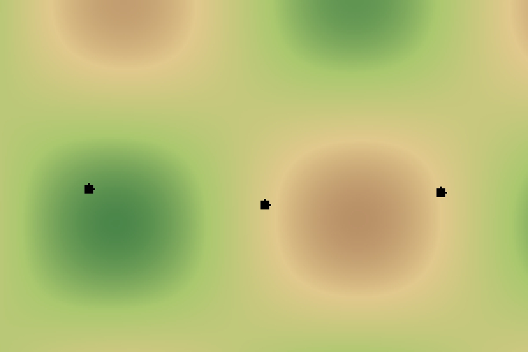
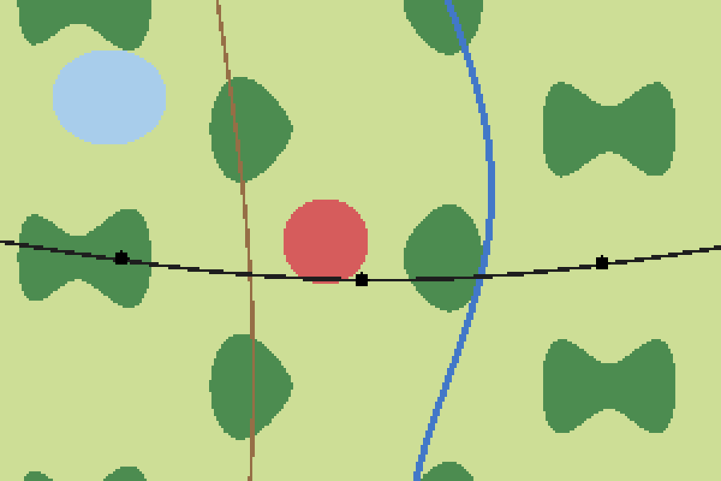
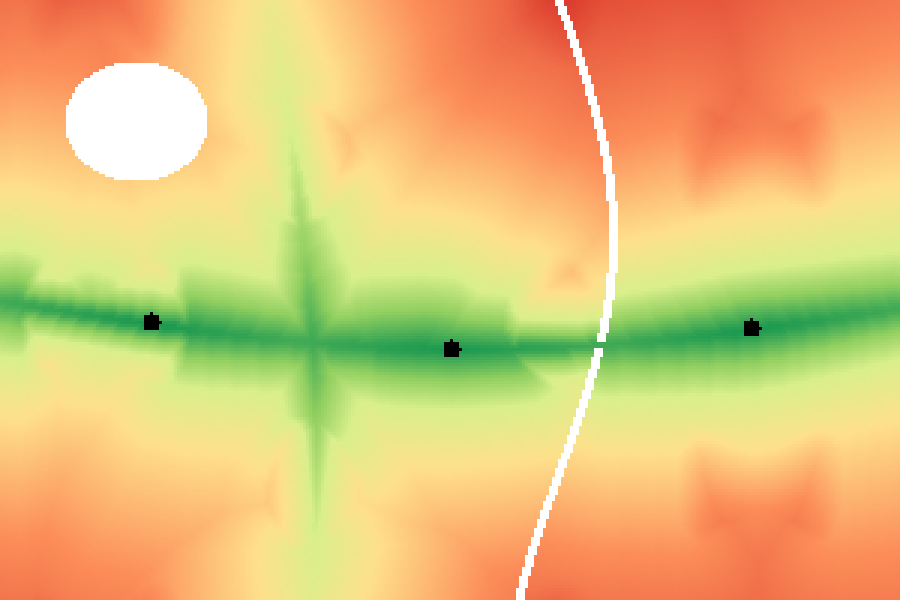

# Tutorial: travel time to health facilities

This walk-through runs a complete travel-time analysis on a small synthetic
landscape shipped in [`data/`](data/). It takes a few minutes and shows every
input and output of the `accessmod` command.

## 1. Build and check the tool

```sh
cargo build --release -p accessmod-cli
export PATH="$PWD/target/release:$PATH"
accessmod doctor
```

`doctor` reports the GDAL and PROJ versions, the raster and vector drivers,
whether coordinate transformations work and whether the scratch directory is
writable. Every line must read `ok`.

## 2. The inputs

`data/` holds a 300 × 200 grid of 100 m cells (30 × 20 km, EPSG:32632):

| File | Content |
| --- | --- |
| `dem.tif` | Elevation (m). **It defines the grid**: every other raster must lie on its cells. |
| `land_cover.tif` | Integer land-cover classes, see below. |
| `facilities.gpkg` | Three health facilities (points), identified by the field `code`. |
| `job.json` | The analysis to run. |

| Elevation | Land cover and facilities (black squares) |
| --- | --- |
|  |  |

Land-cover classes: 1 built area (red), 2 grassland (light green), 3 forest
(dark green), 1001 main road (black), 1002 secondary road (brown), 9 river
(blue), and a lake left as NoData (pale blue).

Look at any dataset with `inspect`:

```sh
accessmod dataset inspect docs/tutorial/data/dem.tif
accessmod dataset inspect docs/tutorial/data/facilities.gpkg --json
```

For a raster, `usable_as_dem` says whether it can define a grid: projected
CRS in metres, north-up, not rotated.

## 3. The job

[`data/job.json`](data/job.json) describes the analysis. Relative paths are
resolved against the job file's directory.

```json
{
  "schema_version": 1,
  "dem": "dem.tif",
  "land_cover": "land_cover.tif",
  "facilities": { "path": "facilities.gpkg", "id_field": "code" },
  "scenario": [
    { "class": 1, "mode": "walking", "speed_kmh": 5, "label": "built area" },
    { "class": 2, "mode": "walking", "speed_kmh": 4, "label": "grassland" },
    { "class": 3, "mode": "walking", "speed_kmh": 2, "label": "forest" },
    { "class": 1001, "mode": "motorized", "speed_kmh": 60, "label": "main road" },
    { "class": 1002, "mode": "bicycling", "speed_kmh": 15, "label": "secondary road" }
  ],
  "method": "anisotropic",
  "direction": "towards_facilities",
  "neighbourhood": 16,
  "outputs": { "direction": true },
  "output_dir": "out"
}
```

- **scenario**: speed (km/h on flat ground) and transport mode of each
  class. A class missing from the scenario, like the river (9), is a
  **barrier**; so are NoData cells (the lake) in the land cover or the DEM.
- **method**: `anisotropic` adjusts speeds to the slope (Tobler's function
  for walking, a physical model for bicycling, constant for motorized);
  `isotropic` ignores the slope.
- **direction**: `towards_facilities` is the time *to reach* a facility from
  each cell (uphill and downhill are swapped compared to
  `from_facilities`).
- **neighbourhood**: 8 (cardinal and diagonal moves) or 16 (plus knight
  moves, more accurate).
- **limit_s** (optional): cells further than this many seconds are left
  unreached.

The full schema is printed by `accessmod travel-time schema`.

## 4. Validate, then run

```sh
accessmod travel-time validate --job docs/tutorial/data/job.json
accessmod travel-time run --job docs/tutorial/data/job.json
```

`validate` reads every input and reports **all** problems at once: misaligned
rasters, facilities outside the grid or on a barrier, invalid speeds, a
non-empty output directory, too little memory. Here it also warns that class
9 has no scenario and is therefore a barrier, which is intended.

`run` does the same checks, computes and writes `data/out/`. Outputs are
written to a temporary directory and moved in place only when complete:
`Ctrl-C` leaves nothing behind. An existing, non-empty `out/` is never
overwritten; delete it to run again.

Add `--json` to get a machine-readable report on stdout (messages always go
to stderr). Exit codes: 0 success, 2 invalid job, 3 file error,
4 computation error, 130 cancelled.

## 5. The outputs

| File | Content |
| --- | --- |
| `travel_time_seconds.tif` | Travel time to the nearest facility, **seconds** (Float64, NoData −9999). |
| `nearest_facility.tif` | Which facility is nearest in time (cost allocation): 1, 2, 3… (UInt32, NoData 0). |
| `nearest_facility.json` | Maps those numbers to the facility `code`, with each facility's cell. |
| `path_distance_m.tif` | Length of the fastest path, metres (Float64, NoData −9999). |
| `direction.tif` | Last step of the fastest path, codes 1–16 ([cost model](../cost-model.md)); 0 on facilities, 255 unreached. |
| `job.resolved.json` | The job as run: absolute paths, defaults filled in. Re-run it with `--job`. |
| `run.json` | Report: input checksums, counts, warnings, known differences from AccessMod 5, timings, memory. |

| Travel time (green < 15 min … red > 4 h) | Nearest facility |
| --- | --- |
|  |  |

Things to notice:

- the main road (60 km/h) carries fast travel across the whole width;
- the river is crossed only at the road bridge, so the eastern catchment
  stops at the river elsewhere;
- the lake and the river stay white (unreached barriers);
- times are seconds; convert to minutes for display only.

An excerpt of `run.json`:

```json
"result": {
  "reached_cells": 57909,
  "max_travel_time_s": 13642.887047819444,
  "max_path_distance_m": 22415.092303249126
}
```

## 6. Without a job file

The same analysis from the command line; `job.resolved.json` is still
written, so the run stays reproducible:

```sh
accessmod travel-time run \
  --dem docs/tutorial/data/dem.tif \
  --land-cover docs/tutorial/data/land_cover.tif \
  --facilities docs/tutorial/data/facilities.gpkg --id-field code \
  --class 1=walking:5 --class 2=walking:4 --class 3=walking:2 \
  --class 1001=motorized:60 --class 1002=bicycling:15 \
  --method anisotropic --direction towards_facilities --neighbourhood 16 \
  --output-dir /tmp/accessmod-tutorial
```

## 7. Memory, threads, large grids

Results never depend on these settings; only speed does.

- `--memory 2G`: memory budget (default: half the available memory). Grids
  larger than the budget are kept in tiles on disk; the run fails early,
  with both estimates, if the budget is too small.
- `--tmp-dir DIR`: where those tiles go (default: system temporary
  directory).
- `--threads N`: threads for GeoTIFF compression.

## 8. Referral: time and distance between facilities

[`data/referral.json`](data/referral.json) computes travel time and path
distance from every facility to every other one (same scenario):

```sh
accessmod referral run --job docs/tutorial/data/referral.json
```

`origins` and `destinations` are two facility layers (here the same one);
each accepts a `where` attribute filter, e.g. `"where": "type = 'hospital'"`.
Pairs from a facility to itself are dropped (`self_pairs: true` keeps them).

Outputs in `out-referral/`:

| File | Content |
| --- | --- |
| `referral.csv` | One row per pair: `origin_id,destination_id,time_s,distance_m` (empty when unreachable). |
| `nearest_by_time.csv` | For each origin, the destination(s) reached first; ties are all kept. |
| `nearest_by_distance.csv` | For each origin, the destination(s) with the shortest path (among least-time paths). |
| `run.json`, `job.resolved.json` | As for travel time. |

```text
origin_id,destination_id,time_s,distance_m
HF-01,HF-02,613.8165442942285,10230.27573823714
HF-01,HF-03,1223.7313993492196,20395.523322487
HF-02,HF-01,613.8165442942285,10230.27573823714
…
```

Each origin needs one search over the grid, stopped as soon as every
destination is reached; searches run in parallel (`--threads`). When there
are fewer destinations than origins, searches start from the destinations
with slopes inverted (`"search_from": "auto"`), which gives the same times
up to floating-point rounding; `"search_from": "origins"` forces forward
searches. `"nearest_only": true` stops each search at the nearest
destination(s), much faster on large grids.

## Regenerating the data and figures

```sh
cargo run --release -p accessmod-io --example synthetic_inputs -- docs/tutorial/data
accessmod travel-time run --job docs/tutorial/data/job.json
sh docs/tutorial/render.sh   # needs the GDAL command-line tools
```

The generator takes optional `cols rows facilities` arguments; the
benchmarks use it for larger grids.
